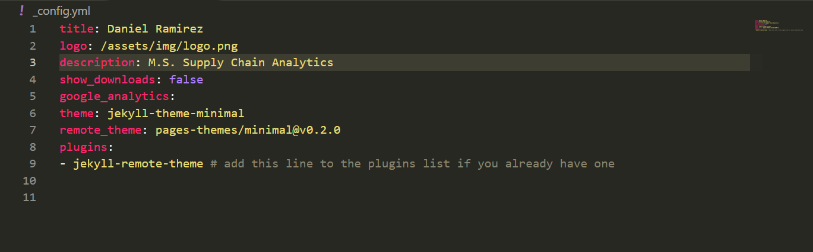
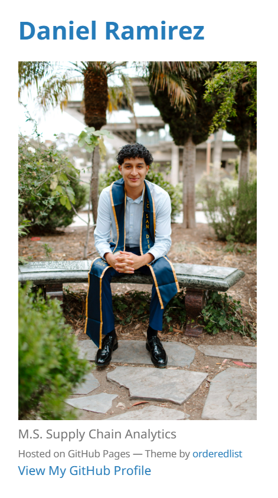
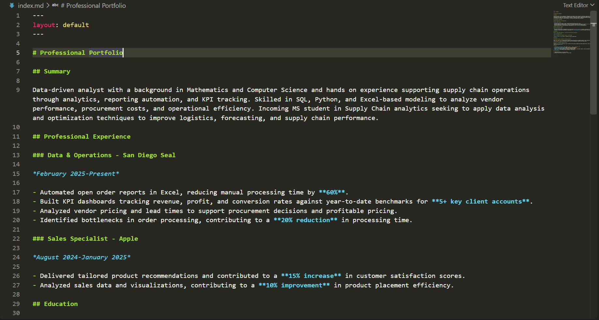
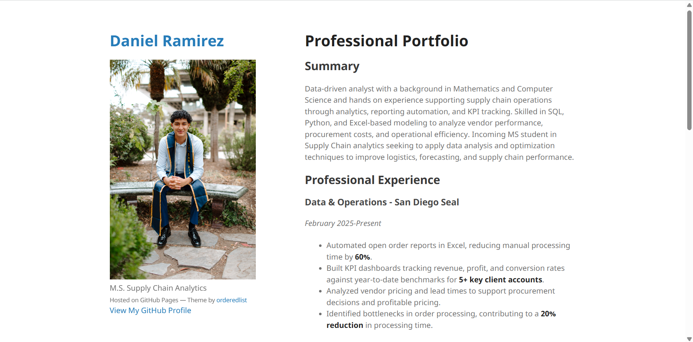

# How I Built My E-Portfolio Using GitHub Pages

## Introduction

I created my e-portfolio to showcase my education, professional experience, projects, and technical skills. My portfolio highlights my background in Mathematics and Computer Science and my interest in supply chain analytics.

For Milestone I, I customized the Minimal Jekyll theme and hosted my portfolio using GitHub Pages. This guide explains how to recreate the website, including setting up the repository, configuring the theme, adding a headshot, and organizing the homepage using Markdown.

- [Visit my e-portfolio](https://dannyr742.github.io/)
- [View my GitHub repository](https://github.com/dannyr742/dannyr742.github.io)

## 1. Create the Website Repository

Create a public repository named:

```text
dannyr742.github.io
```

For a personal GitHub Pages website, the repository name follows the format `username.github.io`.

My repository contains the Markdown content, configuration settings, images, and theme files for my portfolio.

## 2. Add the Minimal Theme

### 2.1 Obtain the Theme Files

The starting point for my portfolio was the [Minimal theme](https://github.com/pages-themes/minimal).

To recreate my setup, download the theme files and place their contents in the root of the website repository. The files should be directly inside the repository rather than inside an additional `minimal` folder.

### 2.2 Choose a Simple Layout

The Minimal theme provides a clean layout with a profile area on the left and portfolio content on the right. This made it a useful starting point for presenting my background in an organized way.

Rather than designing the entire website from scratch, I customized the theme with my own information.

## 3. Customize the Website Configuration

### 3.1 Edit `_config.yml`

Open `_config.yml` and update the website settings.

My configuration includes:

```yaml
title: Daniel Ramirez
logo: /assets/img/logo.png
description: M.S. Supply Chain Analytics
show_downloads: false
google_analytics:
theme: jekyll-theme-minimal
remote_theme: pages-themes/minimal@v0.2.0
plugins:
  - jekyll-remote-theme
```

These changes replace the theme's general information with details specific to my portfolio.



## 4. Add a Personal Headshot

### 4.1 Upload the Image

Place the profile image in the following location:

```text
assets/img/logo.png
```

The image filename and capitalization must match the path in `_config.yml`.

### 4.2 Connect the Image to the Theme

The configuration line below tells the theme where to find the image:

```yaml
logo: /assets/img/logo.png
```

On my website, this displays my graduation photo beneath my name. Adding the photo makes the portfolio more personal and helps visitors connect the work to its author.




## 5. Build the Homepage Using Markdown

### 5.1 Set the Page Layout

Open the root `index.md` and add the following at the top to use the theme’s default layout:

```yaml
---
layout: default
---
```

### 5.2 Customize the Content

Replace the theme’s sample content with your own portfolio information. I organized my homepage into Summary, Professional Experience, Education, Projects, Skills, and Certifications.

I used Markdown to format the page:
- `#` for the page title.
- `##` for section headings.
- `###` for subsection headings.
- Hyphens for bullet points.
- Double asterisks for **bold text**.
- Single asterisks for *italic text*.

These changes turned the sample homepage into a professional portfolio.



## 6. Preview and Commit the Changes

### 6.1 Preview the Markdown

When editing in Visual Studio Code, open `index.md` and select **Open Preview to the Side**.

This displays the Markdown source and its preview next to each other. Check that headings, lists, and text formatting appear correctly.

The Markdown preview helps check the content, while the published website shows the complete Jekyll theme.

### 6.2 Save Changes with Commits

Save the edited files and commit the changes to the repository.

Use descriptive commit messages, such as:

```text
Customize portfolio title and profile image
```

```text
Add professional experience and project descriptions
```

If working locally, push the commits to GitHub so the online repository receives the updates.

## 7 Review the Published Portfolio

After the deployment finishes, visit:

[https://dannyr742.github.io/](https://dannyr742.github.io/)

Check that:

- My name and academic description appear correctly.
- The profile photo loads.
- The homepage sections are organized and readable.
- Bold text, dates, and lists display correctly.
- The GitHub profile link works.
- The page displays the customized portfolio instead of the original theme demonstration.

## 8. Final E-Portfolio

The finished portfolio combines the Minimal theme with my own photo, professional summary, work experience, education, projects, skills, and certifications.

It provides a central place to present my background and can be expanded with additional projects and subpages as I complete more work.



## Resources

- [Minimal Theme Repository and Instructions](https://github.com/pages-themes/minimal)